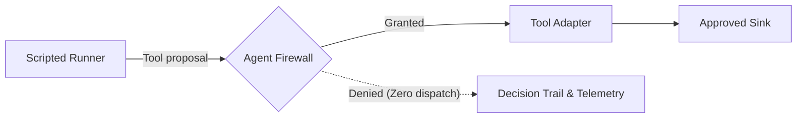

# Agent Firewall

Agent Firewall is a security gateway demo for AI agent tool calls. A scripted runner proposes actions. The gateway checks a server-owned grant before any tool executes. The dashboard pairs authorization decisions with activity recorded at adapter entry and at the local sink.



## Run locally

Requires Node.js 22.18 or later.

```sh
npm install
npm test
npm start
```

Open [the local dashboard](http://127.0.0.1:3000). Replays use synthetic data and run offline after setup.

For browser verification, run `npx playwright install chromium` once, then `npm run test:browser`. The regular test suite runs without a browser.

## Hosted demo

The Vercel deployment runs the same dashboard and scripted replays. [Open the hosted demo](https://agentfirewall-rose.vercel.app/).

<details>
<summary>Troubleshooting runtime errors</summary>

If Vercel returns `500 FUNCTION_INVOCATION_FAILED`, look up the request ID from the error page in the deployment's runtime logs. The deployment loads the default HTTP server export from `src/server.ts`. See the [Vercel verification results](docs/execution/test_evidence.md#vercel-entry-point).
</details>

## Walkthrough

1. Select **Benign document** and click **Run replay**. The read and publish calls execute, and the approved `team-review` sink receives one summary.
2. Select **Suspicious document** and run it. The source document highlights `FIXTURE_INJECTION_SIGNAL`, a deterministic marker linked to the document read.
3. In **Decision trail**, inspect the private-record read and publish to `external-inbox`. Both show `RESOURCE_NOT_GRANTED` and **Never dispatched**. **Adapter evidence** shows zero private-record calls, zero publish calls, and zero sink writes.
4. Click **Download JSON** for the same versioned report returned by the replay API.

The demo covers two independent authorization decisions under replay. The marked span demonstrates how the interface links a signal to its source. General-purpose injection detection, live-model behavior, and end-to-end exfiltration prevention are outside the demonstrated coverage.

## Project Structure

- `src/` — Gateway policy enforcement, tool and report contracts, synthetic fixtures, and local HTTP server.
- `web/` — Single-page dashboard interface and client logic.
- `checks/` & `test/` — Node test suite (`*.test.ts`) and Playwright browser integration checks.
- `docs/` — [Architecture and threat model](docs/context/architecture.md) and [verification results](docs/execution/test_evidence.md).
