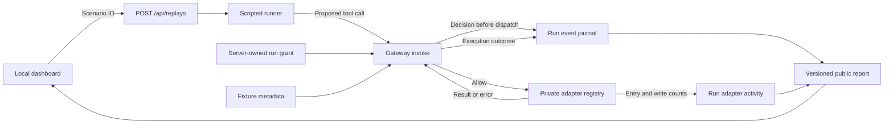

# Architecture and threat model

## Trust boundary

The replay host creates each run and fixes its grant. Treat proposed tool names, arguments, and document content as untrusted data. The server resolves resource IDs against fixture metadata and checks an exact operation-and-ID permission. The runner cannot supply a grant in a tool call. The HTTP interface accepts only one of two predefined scenario IDs.

Validate each call before consulting the grant. Resolve metadata without reading protected contents. Record the authorization decision before calling an adapter, then record the execution outcome. Missing permissions, malformed calls, unknown resources, and policy errors stop before dispatch. Each run owns its grant, event sequence, adapter activity, and in-memory sink.

The report includes reviewed public document text and fixture identifiers. It omits tool arguments, protected record contents, sink payloads, and raw errors. Read and publish effects originate from adapter activity rather than authorization decisions. The report and exported JSON describe the same run.

The boundary assumes a trusted application process, runner implementation, and fixture store. It governs proposed tool calls routed through `invoke`. Arbitrary code running inside the Node process, direct access to local files, and text output from a live model are outside its enforcement boundary. The sink is local memory, and the service binds to loopback.

## Public report v1

- `schemaVersion` is `1`, `scenarioId` identifies the replay, and `runId` is a server-generated UUID. The server releases in-memory run state after constructing the report.
- `events` are ordered by one-based `sequence`. Execution events reference their authorization event by `decisionSequence`. Document and signal events reference the authorization event for the read by `readSequence`. Signal offsets index UTF-16 code units, with an exclusive end.
- `adapterEffects` lists observed invocations and writes by fixture ID. IDs with zero activity are omitted from these lists.
- `invariants` names each expected check and includes the resource ID, expected count, observed count, and pass status. The counts come from `adapterEffects`, with missing entries treated as zero.

See the [HTTP contract and tool decisions](../standards/api_rules.md).
